# Ricette Pinta (italiano)

Fonte: PDF «RICETTE ALL GRAIN - E+G» di pinta.it. Tabelle ricavate automaticamente dal testo del PDF: controllare le quantità prima dell'uso.

## Indice

<table>
<tr><td colspan="6"><b>Lager</b></td></tr>
<tr>
<td align="center" valign="top" width="150"><a href="#pilsner">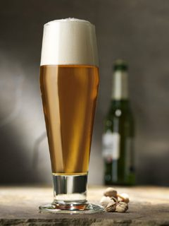</a> <a href="#pilsner">Pilsner</a> <small>5D German Pils</small></td>
<td align="center" valign="top" width="150"><a href="#bock-beer">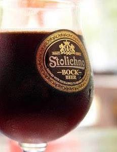</a> <a href="#bock-beer">Bock Beer</a> <small>6C Dunkles Bock</small></td>
<td align="center" valign="top" width="150"><a href="#oktoberfest">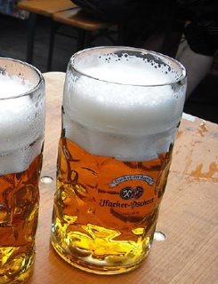</a> <a href="#oktoberfest">Oktoberfest</a> <small>6A Märzen</small></td>
<td align="center" valign="top" width="150"><a href="#dark-amber-lager">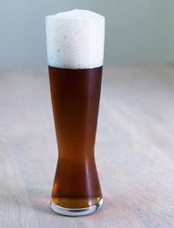</a> <a href="#dark-amber-lager">Dark Amber Lager</a> <small>2C International Dark Lager</small></td>
<td align="center" valign="top" width="150"><a href="#saphir-lager">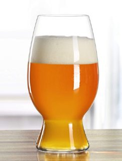</a> <a href="#saphir-lager">Saphir Lager</a> <small>5D German Pils</small></td>
<td align="center" valign="top" width="150"><a href="#rauchbier">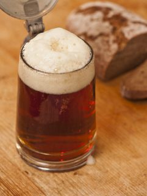</a> <a href="#rauchbier">Rauchbier</a> <small>6B Rauchbier</small></td>
</tr>
<tr><td colspan="6"><b>Frumento e witbier</b></td></tr>
<tr>
<td align="center" valign="top" width="150"><a href="#weizen">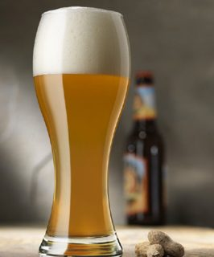</a> <a href="#weizen">Weizen</a> <small>10A Weissbier</small></td>
<td align="center" valign="top" width="150"><a href="#dunkelweizen">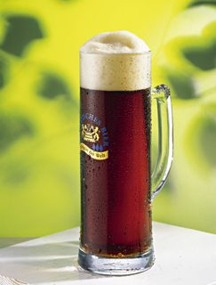</a> <a href="#dunkelweizen">Dunkelweizen</a> <small>10B Dunkles Weissbier</small></td>
<td align="center" valign="top" width="150"><a href="#american-wheat">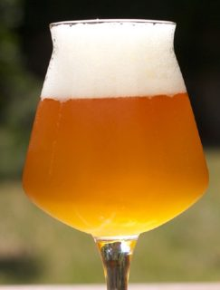</a> <a href="#american-wheat">American Wheat</a> <small>1D American Wheat Beer</small></td>
<td align="center" valign="top" width="150"><a href="#mandarina-exp-wheat">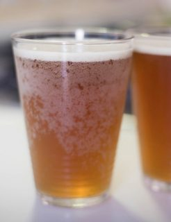</a> <a href="#mandarina-exp-wheat">Mandarina EXP Wheat</a> <small>1D American Wheat Beer (incerta)</small></td>
<td align="center" valign="top" width="150"><a href="#belgian-blanche">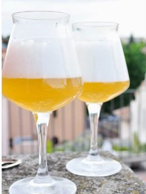</a> <a href="#belgian-blanche">Belgian Blanche</a> <small>24A Witbier</small></td>
<td align="center" valign="top" width="150"> <a href="#american-witbier">American Witbier</a> <small>24A Witbier</small></td>
</tr>
<tr>
<td align="center" valign="top" width="150"><a href="#new-world-wit">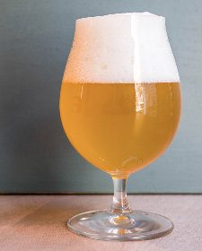</a> <a href="#new-world-wit">New World Wit</a> <small>24A Witbier</small></td>
<td align="center" valign="top" width="150"><a href="#blanc-ale">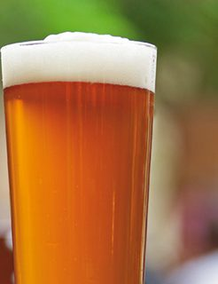</a> <a href="#blanc-ale">Blanc Ale</a> <small>1D American Wheat Beer (incerta)</small></td>
</tr>
<tr><td colspan="6"><b>Pale ale, IPA e chiare</b></td></tr>
<tr>
<td align="center" valign="top" width="150"><a href="#golden-summer-beer">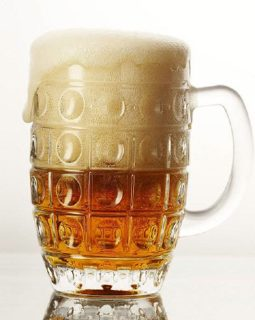</a> <a href="#golden-summer-beer">Golden Summer Beer</a> <small>12A British Golden Ale</small></td>
<td align="center" valign="top" width="150"><a href="#blonde-ale">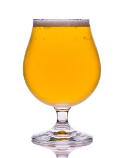</a> <a href="#blonde-ale">Blonde Ale</a> <small>18A Blonde Ale</small></td>
<td align="center" valign="top" width="150"><a href="#american-pale-ale">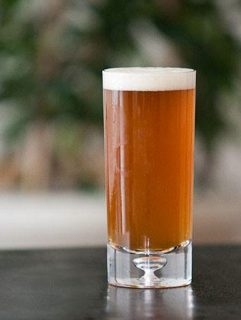</a> <a href="#american-pale-ale">American Pale Ale</a> <small>18B American Pale Ale</small></td>
<td align="center" valign="top" width="150"><a href="#australian-pale-ale">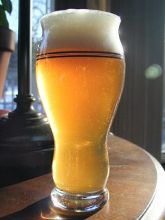</a> <a href="#australian-pale-ale">Australian Pale Ale</a> <small>18B American Pale Ale</small></td>
<td align="center" valign="top" width="150"> <a href="#apa-burst">APA Burst</a> <small>18B American Pale Ale</small></td>
<td align="center" valign="top" width="150"><a href="#american-sabro-ale">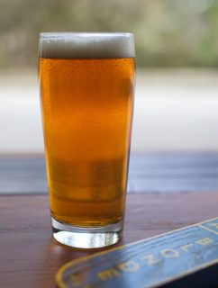</a> <a href="#american-sabro-ale">American Sabro Ale</a> <small>18B American Pale Ale</small></td>
</tr>
<tr>
<td align="center" valign="top" width="150"><a href="#lemon-ipa">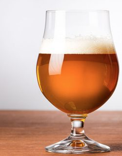</a> <a href="#lemon-ipa">Lemon IPA</a> <small>21A American IPA (incerta)</small></td>
<td align="center" valign="top" width="150"><a href="#nz-session-ale">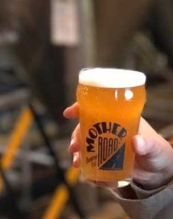</a> <a href="#nz-session-ale">NZ Session Ale</a> <small>18B American Pale Ale</small></td>
<td align="center" valign="top" width="150"><a href="#topaz-au-pale-ale">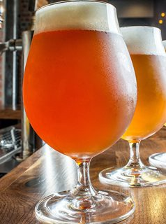</a> <a href="#topaz-au-pale-ale">Topaz Au Pale Ale</a> <small>18B American Pale Ale (incerta)</small></td>
<td align="center" valign="top" width="150"><a href="#rye-pale-ale">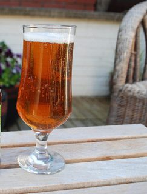</a> <a href="#rye-pale-ale">Rye Pale Ale</a> <small>18B American Pale Ale</small></td>
<td align="center" valign="top" width="150"><a href="#citrus-ale">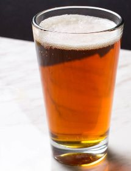</a> <a href="#citrus-ale">Citrus Ale</a> <small>18B American Pale Ale</small></td>
<td align="center" valign="top" width="150"><a href="#melon-ale">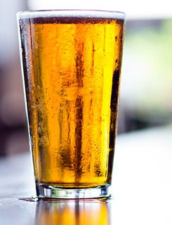</a> <a href="#melon-ale">Melon-Ale</a> <small>18B American Pale Ale</small></td>
</tr>
<tr>
<td align="center" valign="top" width="150"><a href="#american-ale">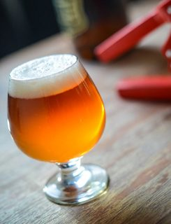</a> <a href="#american-ale">American Ale</a> <small>18B American Pale Ale</small></td>
<td align="center" valign="top" width="150"><a href="#black-ipa">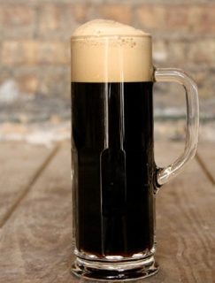</a> <a href="#black-ipa">Black IPA</a> <small>21B Specialty IPA: Black IPA</small></td>
<td align="center" valign="top" width="150"><a href="#summit-black-ipa">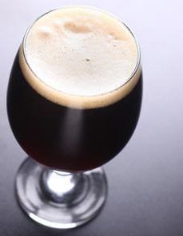</a> <a href="#summit-black-ipa">Summit Black IPA</a> <small>21B Specialty IPA: Black IPA</small></td>
<td align="center" valign="top" width="150"><a href="#neipa">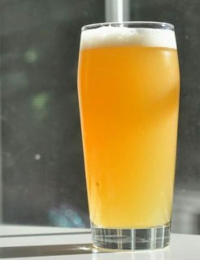</a> <a href="#neipa">NEIPA</a> <small>21C Hazy IPA</small></td>
<td align="center" valign="top" width="150"><a href="#european-ale">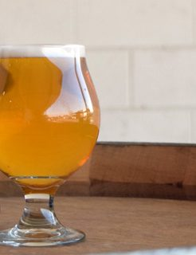</a> <a href="#european-ale">European Ale</a> <small>18B American Pale Ale</small></td>
</tr>
<tr><td colspan="6"><b>Ambrate, rosse e brune</b></td></tr>
<tr>
<td align="center" valign="top" width="150"><a href="#best-bitter">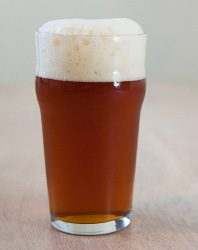</a> <a href="#best-bitter">Best Bitter</a> <small>11B Best Bitter</small></td>
<td align="center" valign="top" width="150"><a href="#american-amber-ale">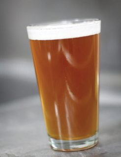</a> <a href="#american-amber-ale">American Amber Ale</a> <small>19A American Amber Ale</small></td>
<td align="center" valign="top" width="150"><a href="#american-brown-ale">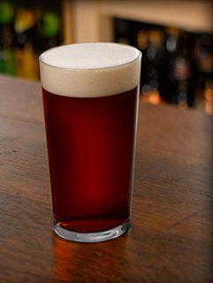</a> <a href="#american-brown-ale">American Brown Ale</a> <small>19C American Brown Ale</small></td>
<td align="center" valign="top" width="150"><a href="#west-coast-brown-ale">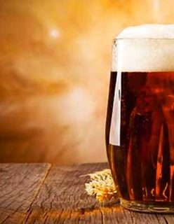</a> <a href="#west-coast-brown-ale">West Coast Brown Ale</a> <small>19C American Brown Ale</small></td>
<td align="center" valign="top" width="150"><a href="#irish-red-ale">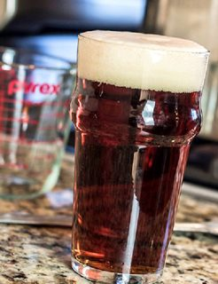</a> <a href="#irish-red-ale">Irish Red Ale</a> <small>15A Irish Red Ale</small></td>
<td align="center" valign="top" width="150"><a href="#mild-ale">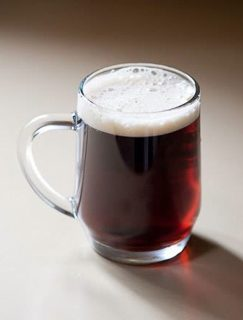</a> <a href="#mild-ale">Mild Ale</a> <small>13A Dark Mild</small></td>
</tr>
<tr>
<td align="center" valign="top" width="150"><a href="#rye-mild">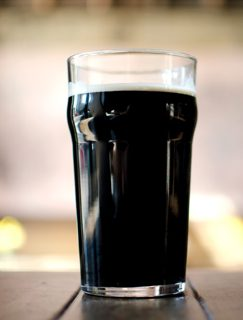</a> <a href="#rye-mild">Rye Mild</a> <small>13A Dark Mild</small></td>
<td align="center" valign="top" width="150"><a href="#scottish-heavy">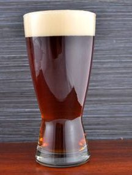</a> <a href="#scottish-heavy">Scottish Heavy</a> <small>14B Scottish Heavy</small></td>
<td align="center" valign="top" width="150"><a href="#english-ale">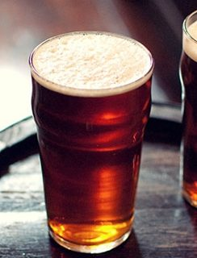</a> <a href="#english-ale">English Ale</a> <small>11A Ordinary Bitter (incerta)</small></td>
<td align="center" valign="top" width="150"><a href="#california-common">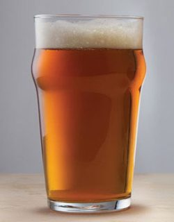</a> <a href="#california-common">California Common</a> <small>19B California Common</small></td>
</tr>
<tr><td colspan="6"><b>Porter e stout</b></td></tr>
<tr>
<td align="center" valign="top" width="150"><a href="#london-porter">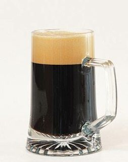</a> <a href="#london-porter">London Porter</a> <small>13C English Porter</small></td>
<td align="center" valign="top" width="150"><a href="#chocolate-porter">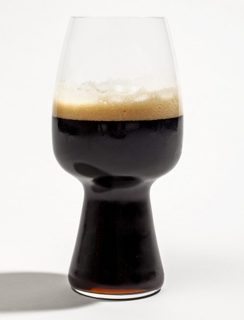</a> <a href="#chocolate-porter">Chocolate Porter</a> <small>20A American Porter (incerta)</small></td>
<td align="center" valign="top" width="150"> <a href="#irish-stout">Irish Stout</a> <small>15B Irish Stout</small></td>
<td align="center" valign="top" width="150"><a href="#coffee-stout">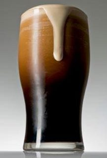</a> <a href="#coffee-stout">Coffee Stout</a> <small>20B American Stout</small></td>
<td align="center" valign="top" width="150"><a href="#ginger-rye-1">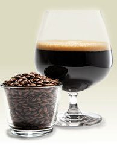</a> <a href="#ginger-rye-1">Ginger Rye</a> <small>20A American Porter</small></td>
</tr>
<tr><td colspan="6"><b>Belga e saison</b></td></tr>
<tr>
<td align="center" valign="top" width="150"><a href="#belgian-dubbel">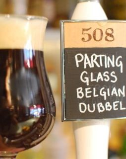</a> <a href="#belgian-dubbel">Belgian Dubbel</a> <small>26B Belgian Dubbel</small></td>
<td align="center" valign="top" width="150"><a href="#belgian-tripel">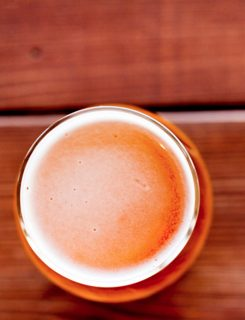</a> <a href="#belgian-tripel">Belgian Tripel</a> <small>26C Belgian Tripel</small></td>
<td align="center" valign="top" width="150"><a href="#abbey-beer">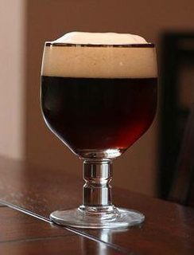</a> <a href="#abbey-beer">Abbey Beer</a> <small>26B Belgian Dubbel (incerta)</small></td>
<td align="center" valign="top" width="150"><a href="#paters-beer">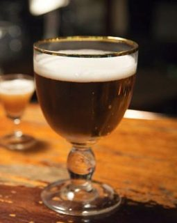</a> <a href="#paters-beer">Paters Beer</a> <small>26A Belgian Single</small></td>
<td align="center" valign="top" width="150"> <a href="#belgian-speciality-ale">Belgian Speciality Ale</a> <small>24B Belgian Pale Ale (incerta)</small></td>
<td align="center" valign="top" width="150"><a href="#belgian-amber-ale">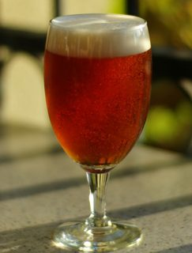</a> <a href="#belgian-amber-ale">Belgian Amber Ale</a> <small>24B Belgian Pale Ale</small></td>
</tr>
<tr>
<td align="center" valign="top" width="150"><a href="#saison">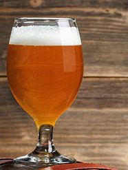</a> <a href="#saison">Saison</a> <small>25B Saison</small></td>
<td align="center" valign="top" width="150"><a href="#rye-saison">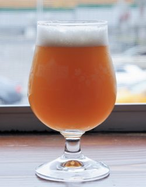</a> <a href="#rye-saison">Rye Saison</a> <small>25B Saison</small></td>
<td align="center" valign="top" width="150"> <a href="#tropic-saison">Tropic Saison</a> <small>25B Saison</small></td>
<td align="center" valign="top" width="150"> <a href="#belgian-strong-ale">Belgian Strong Ale</a> <small>25C Belgian Golden Strong Ale</small></td>
</tr>
<tr><td colspan="6"><b>Forti e invecchiate</b></td></tr>
<tr>
<td align="center" valign="top" width="150"> <a href="#barley-wine">Barley Wine</a> <small>17D English Barley Wine</small></td>
<td align="center" valign="top" width="150"> <a href="#old-ale">Old Ale</a> <small>17B Old Ale</small></td>
</tr>
<tr><td colspan="6"><b>Speziate e stagionali</b></td></tr>
<tr>
<td align="center" valign="top" width="150"> <a href="#polaris-mojito">Polaris Mojito</a> <small>30A Spice, Herb, or Vegetable Beer (incerta)</small></td>
<td align="center" valign="top" width="150"> <a href="#ginger-rye">Ginger Rye</a> <small>30A Spice, Herb, or Vegetable Beer</small></td>
<td align="center" valign="top" width="150"> <a href="#winter-warmer">Winter Warmer</a> <small>30C Winter Seasonal Beer</small></td>
</tr>
</table>

## American Pale Ale

**Stile BJCP 2021:** 18B American Pale Ale

**Descrizione:** L’ esaltazione dei luppoli da ampie sfaccettature aromatiche che si fondono con l’amaro classico delle Pale Ale.

### Parametri

| Parametro | Valore |
|---|---|
| Litri | 23 |
| OG | 1048 |
| FG | circa 1011 |
| Alcol | 4.8 gradi circa |
| Priming | 5gr/litro |

### Malti ed estratti

| Quantità | Ingrediente |
|---|---|
| 4 kg | Bairds Maris Otter 100% |
| 200 gr | Ireks Karamell Wasserhell |
| 250 gr | BairdsCrystal Light |

### Luppoli

| Quantità | Luppolo | Alfa | Tempo / Metodo |
|---|---|---|---|
| 15 gr | AMARILLO | 7.9 | 60min |
| 15 gr | CASCADE | 5.8 | 45min |
| 15 gr | AMARILLO | 7.9 | 15 min |
| 25 gr | CENTENNIAL | 9.2 | 15 min |
| 20 gr | AMARILLO + 25gr CENTENNIAL in dry hopping |  |  |

### Ammostamento

- MASH 66°C per 60 min
- MASH OUT 78°C per 15 min

### Lievito

- Lievito US05 oppure WLP001

### Altre note

- Per estratto+grani sostituire Maris Otter con 3kg di estratto liquido light

## Pilsner

**Stile BJCP 2021:** 5D German Pils

**Descrizione:** Bionda, gusto fresco, leggero e piacevolmente amaro. Birra a bassa fermentazione. Si distingue dalle altre birre per il ruolo marcato del luppolo

### Parametri

| Parametro | Valore |
|---|---|
| Litri | 23 |
| OG | 1046 |
| FG | circa 1012 |
| Alcol | 4,6 gradi circa |
| Priming | 5-6 gr/litro |

### Malti ed estratti

| Quantità | Ingrediente |
|---|---|
| 4.8 kg | Ireks Pilsner |

### Luppoli

| Quantità | Luppolo | Alfa | Tempo / Metodo |
|---|---|---|---|
| 45 gr | HERSBRUCKER | 3.0 | 60min |
| 25 gr | TETTNANG | 2.4 | 15 min |

### Ammostamento

- PROTEIN REST 52°C per 10 min.
- MASH 67°C per 50 min.
- MASH-OUT 78°C per 10 min.

### Lievito

- Lievito WLP800 oppure Bohemian Lager M84 2 bustine per 10-15°
- Lievito Nottingham Ale Per 15-24°

### Altre note

- Per estratto+grani sostituire Pilsner con 3kg di estratto liquido extra light e 200gr di estratto secco extralight

## Belgian Dubbel

**Stile BJCP 2021:** 26B Belgian Dubbel

**Descrizione:** Una birra corposa amabile e fruttata che rispetta la tradizione belga. Il colore rosso scuro e profumi di frutta e chiodi di garofano si sposano con una birra dal forte tenore alcolico e un corpo molto importante.

### Parametri

| Parametro | Valore |
|---|---|
| Litri | 23 |
| OG | 1060 |
| FG | circa 1010 |
| Alcol | 6,6 gradi circa |
| Priming | 4-5 gr/lt |

### Malti ed estratti

| Quantità | Ingrediente |
|---|---|
| 5 kg | Château Pilsner |
| 340 gr | Château Biscuit |
| 260 gr | Château Arome |
| 60 gr | Château Special B |
| 500 gr | zucchero candito bruno |

### Luppoli

| Quantità | Luppolo | Alfa | Tempo / Metodo |
|---|---|---|---|
| 24 gr | BOBEK | 4.6 | 60min |
| 12 gr | SAAZ | 2.9 | 15 min |

### Ammostamento

- PROTEIN REST 52°C per 15 min.
- MASH 68°C per 60 min.
- MASH-OUT 78°C per 15 min

### Lievito

- Lievito WLP 545 oppure 2 bustine Belgian Ale M41

### Altre note

- Per estratto+grani sostituire Pilsner con 3 kg di estratto liquido light e 1kg estratto secco light

## Mild Ale

**Stile BJCP 2021:** 13A Dark Mild

**Descrizione:** Una birra poco luppolata dal corpo contenuto, una bevanda beverina che esalta molto il sapore del malto. Quando nel 17o secolo sono stati introdotti i luppoli dalla Germania e dall’Olanda gli inglesi hanno potuto abbassare il corpo delle loro strong ale in quanto il luppolo poteva preservare al meglio le loro birre.

### Parametri

| Parametro | Valore |
|---|---|
| Litri | 23 |
| OG | 1034 |
| FG | circa 1009 |
| Alcol | 3,5 gradi circa |
| Priming | 5-6 gr/lt |

### Malti ed estratti

| Quantità | Ingrediente |
|---|---|
| 3,3 kg | Bairds Pale ale |
| 300 gr | Bairds Crystal Medium |
| 100 gr | Bairds Chocolate |

### Luppoli

| Quantità | Luppolo | Alfa | Tempo / Metodo |
|---|---|---|---|
| 20 gr | CHALLENGER | 7.5 | 60min |
| 10 gr | GOLDINGS | 5.8 | 10min |

### Ammostamento

- MASH 67°C per 60 min
- MASH OUT 78°C per 15 min

### Lievito

- Lievito M15 Empire Ale

### Altre note

- Per estratto+grani sostituire Pale Ale con 2.5 kg di estratto liquido amber

## Best Bitter

**Stile BJCP 2021:** 11B Best Bitter

**Descrizione:** Birra in stile inglese, una birra ricca di sapore, con un tono amarognolo e un gusto ricco come vuole la tradizione

### Parametri

| Parametro | Valore |
|---|---|
| Litri | 23 |
| OG | 1047 |
| FG | circa 1012 |
| Alcol | 4,7 gradi circa |
| Priming | 5 gr/lt |

### Malti ed estratti

| Quantità | Ingrediente |
|---|---|
| 4,8 kg | Bairds Maris Otter Pale Ale |
| 200 gr | Bairds Crystal Medium |
| 50 gr | Bairds Chocolate |

### Luppoli

| Quantità | Luppolo | Alfa | Tempo / Metodo |
|---|---|---|---|
| 25 gr | TARGET | 10.2 | 60min |
| 20 gr | BRAMBLING X | 4.3 | 15 min |
| 16 gr | BRAMBLING X | 4.3 | 5min |

### Ammostamento

- MASH 67°C per 60 min
- MASH OUT 78°C per 10 min

### Lievito

- Lievito WLP005 oppure S-04

### Altre note

- 1 cucchiaio IRISH MOSS (10min)
- Per estratto+grani sostituire Pale Ale con 3kg di estratto liquido light e
- 250gr di estratto secco light

## Blonde Ale

**Stile BJCP 2021:** 18A Blonde Ale

**Descrizione:** Questa ale dal fantastico colore dorato sprigiona profumi e aromi agrumati. Birra dissetante e adatta ad ogni occasione

### Parametri

| Parametro | Valore |
|---|---|
| Litri | 23 |
| OG | 1050 |
| FG | circa 1012 |
| Alcol | 5 gradi circa |
| Priming | 5-6 gr/lt |

### Malti ed estratti

| Quantità | Ingrediente |
|---|---|
| 4,3 kg | Bairds Pale Ale |
| 250 gr | Château Crystal light |
| 250 gr | Château Carablonde |

### Luppoli

| Quantità | Luppolo | Alfa | Tempo / Metodo |
|---|---|---|---|
| 30 gr | PERLE | 5.9 | 60min |
| 30 gr | CHINOOK | 11.2 | 10 min |
| 30 gr | CHINOOK in dry hopping | 11.2 |  |

### Ammostamento

- MASH 68°C per 60 min
- MASH OUT 78°C per 15 min

### Lievito

- Lievito US-05

### Altre note

- Per estratto+grani sostituire Pale Ale con 3kg di estratto liquido extralight e 300 gr di estratto secco extralight

## Barley Wine

**Stile BJCP 2021:** 17D English Barley Wine

**Descrizione:** Una birra rossa, non amara e dal carattere extra forte per le occasioni speciali. Impossibile non apprezzare appieno il sapore e il suo corpo ricco.

### Parametri

| Parametro | Valore |
|---|---|
| Litri | 23 |
| OG | 1080 |
| FG | circa 1019 |
| Alcol | 8,5 gradi circa |
| Priming | 4gr/lt |

### Malti ed estratti

| Quantità | Ingrediente |
|---|---|
| 8,5 kg | Bairds Maris Otter |
| 400 gr | Bairds Crystal Medium |

### Luppoli

| Quantità | Luppolo | Alfa | Tempo / Metodo |
|---|---|---|---|
| 45 gr | TARGET | 10.2 | 60min |
| 20 gr | EAST KENT GOLDING | 5.3 | 15min |
| 10 gr | EAST KENT GOLDING | 5.3 | 5 min |

### Ammostamento

- MASH 68°C per 60 min
- MASH OUT 78°C per 15 min

### Lievito

- Lievito 2 bustine di Nottingham

### Altre note

- Per estratto+grani sostituire Pale Ale con 5.5 kg di estratto liquido light e
- 500gr estratto secco light

## Golden Summer Beer

**Stile BJCP 2021:** 12A British Golden Ale

**Descrizione:** Birra dal colore dorato con un gusto pieno, speziato e luppolato. Una birra dissetante con un delizioso retrogusto agrumato

### Parametri

| Parametro | Valore |
|---|---|
| Litri | 23 |
| OG | 1055 |
| FG | circa 1012-1010 |
| Alcol | 4,7 gradi circa |
| Priming | 5-6 gr/lt |

### Malti ed estratti

| Quantità | Ingrediente |
|---|---|
| 5,2 kg | Bairds Maris Otter |
| 300 gr | Chateau Carablonde |
| 15 gr | buccia di bergamotto (10min) |

### Luppoli

| Quantità | Luppolo | Alfa | Tempo / Metodo |
|---|---|---|---|
| 15 gr | TRADITION | 4.2 | 60min |
| 15 gr | CASCADE | 4 | 30 min |
| 15 gr | CASCADE | 4.8 | 30min |
| 25 gr | CASCADE | 4.8 | 15min |

### Ammostamento

- MASH 67°C per 60 min
- MASH OUT 78°C per 15 min

### Lievito

- Lievito S-04

### Altre note

- Per estratto+grani sostituire Maris Otter con 3kg di estratto liquido light e 500 gr di estratto secco light

## Weizen

**Stile BJCP 2021:** 10A Weissbier

**Descrizione:** Una birra leggera e chiara tipo “Weizen”, dal carattere fresco con un’aroma delicato di malto di frumento ed orzo. Bevanda ideale per l’estate.

### Parametri

| Parametro | Valore |
|---|---|
| Litri | 23 |
| OG | 1056 |
| FG | circa 1014 |
| Alcol | 5,5 gradi circa |
| Priming | 5-6 gr/lt |

### Malti ed estratti

| Quantità | Ingrediente |
|---|---|
| 2,4 kg | Ireks Weizen hell 3 |
| 2 kg | Ireks Pilsner |

### Luppoli

| Quantità | Luppolo | Alfa | Tempo / Metodo |
|---|---|---|---|
| 25 gr | HERSBRUCKER | 3.2 | 60min |
| 10 gr | TETTNANG | 2.2 | 15 min |

### Ammostamento

- PROTEIN REST 52°C per 15 min.
- MASH 66°C per 50 min.
- MASH-OUT 78°C per 15 min.

### Lievito

- Lievito WLP300 oppure Lallemand Munich Classic

### Altre note

- Per estratto+grani sostituire Waizen hell e Pilsner con 3 kg di estratto liquido wheat e 500gr estratto secco light

## Paters Beer

**Stile BJCP 2021:** 26A Belgian Single

**Descrizione:** Questa tipologia di birra trappista è originaria del monastero a Soligny. Questa birra chiamata anche “birra del Papà” è una varietà di birra trappista che inizialmente era stata pensata per essere bevuta solo dai monaci.

### Parametri

| Parametro | Valore |
|---|---|
| Litri | 23 |
| OG | 1085 |
| FG | circa 1018 |
| Alcol | 8 gradi circa |
| Priming | 5gr/lt |

### Malti ed estratti

| Quantità | Ingrediente |
|---|---|
| 5 kg | Bairds Maris Otter |
| 450 gr | Château Munich |
| 230 gr | Château Crystal |
| 25 gr | Château Black |
| 250 gr | miele e 400gr zucchero candito bruno a fine bollitura |

### Luppoli

| Quantità | Luppolo | Alfa | Tempo / Metodo |
|---|---|---|---|
| 52 gr | MITTLEFRUH | 3.5 | 60min |
| 28 gr | GOLDING | 5.3 | 40 min |

### Ammostamento

- MASH 68°C per 60 min
- MASH OUT 78°C per 15 min

### Lievito

- Lievito WLP530 oppure 2 busrine Belgian Ale M41

### Altre note

- Per estratto+grani sostituire Monaco e Maris otter con 3 kg di estratto liquido light e 1kg di malto liquido amber

## London Porter

**Stile BJCP 2021:** 13C English Porter

**Descrizione:** Birra di colore scuro con un aroma di malto con leggeri sentori di tostato. Il suo nome fu usato per la prima volta nel XIX secolo, in seguito alla sua grande popolarità tra gli scaricatori di porto di Londra. Aroma moderato di luppolo che si sposa con un corpo equilibrato.

### Parametri

| Parametro | Valore |
|---|---|
| Litri | 23 |
| OG | 1049 |
| FG | circa 1013 |
| Alcol | 4,8 gradi circa |
| Priming | 5gr/lt |

### Malti ed estratti

| Quantità | Ingrediente |
|---|---|
| 4,5 kg | Pauls MARIS OTTER |
| 425 gr | Bairds Crystal Medium |
| 300 gr | Roasted Barley |

### Luppoli

| Quantità | Luppolo | Alfa | Tempo / Metodo |
|---|---|---|---|
| 20 gr | WILLAMETTE | 5.2 | 90min |
| 10 gr | EAST KENT GOLDING | 5.3 | 40 min |
| 15 gr | FUGGLES | 5.4 | 15min |

### Ammostamento

- MASH 66°C per 60 min
- MASH OUT 78°C per 15 min

### Lievito

- Lievito WLP013 oppure Windsor

### Altre note

- 1 cucchiaio IRISH MOSS (10min)
- Per estratto+grani sostituire Maris Otter con 3kg di estratto liquido amber e 300 gr di estratto secco medium

## Belgian Blanche

**Stile BJCP 2021:** 24A Witbier

**Descrizione:** Birra bianca belga, scorrevole e piacevole. Un retrogusto lievemente acidulo come richiama lo stile che la rende perfetta nella stagione estiva

### Parametri

| Parametro | Valore |
|---|---|
| Litri | 23 |
| OG | 1045 |
| FG | circa 1012 |
| Alcol | 5 gradi circa |

### Malti ed estratti

| Quantità | Ingrediente |
|---|---|
| 2,5 kg | Château Pilsner |
| 0.7 kg | Torrified Wheat |
| 1,2 kg | Château Wheat Blanc |
| 300 gr | Fiocchi d’avena |
| 20 gr | Buccia d’arancia amara (15min) |
| 10 gr | Coriandolo in semi (5min) |

### Luppoli

| Quantità | Luppolo | Alfa | Tempo / Metodo |
|---|---|---|---|
| 25 gr | BOBEK | 4,5 | 60min |
| 25 gr | SAAZ | 3.2 | 15 min |

### Ammostamento

- PROTEIN REST 52°C per 15 min.
- MASH 62°C per 30 min.
- MASH 65°C per 30 min.
- MASH 72°C per 10 min.
- MASH-OUT 78°C per 10 min.

### Lievito

- Lievito WLP400 oppure MJ Belgian Wit M21

## American Wheat

**Stile BJCP 2021:** 1D American Wheat Beer

**Descrizione:** Una birra dal colore dorato e dal corpo medio. Il frumento si sposa con il luppolo americano donandole profumi e aromi più agrumati rispetto alle Wheatbier di matrice tedesca.

### Parametri

| Parametro | Valore |
|---|---|
| Litri | 23 |
| OG | 1055 |
| FG | circa 1008 |
| Alcol | 5 gradi circa |
| Priming | 5-6 gr/lt |

### Malti ed estratti

| Quantità | Ingrediente |
|---|---|
| 2,8 kg | Ireks Weizen hell 3 |
| 2 kg | Ireks Pilsner |

### Luppoli

| Quantità | Luppolo | Alfa | Tempo / Metodo |
|---|---|---|---|
| 25 gr | CASCADE | 5.8 | 60min |
| 15 gr | CASCADE | 5.8 | 10 min |
| 40 gr | AMARILLO | 5.8 | 10 min |

### Ammostamento

- PROTEIN REST 52°C per 15 min.
- MASH 66°C per 50 min.
- MASH-OUT 78°C per 15 min.

### Lievito

- Lievito US West Coast

### Altre note

- Per estratto+grani sostituire Waizen hell e Pilsner con 3 kg di estratto liquido wheat e 500gr estratto secco light

## Abbey Beer

**Stile BJCP 2021:** 26B Belgian Dubbel — **incerta**, alternativa: 26A Belgian Single

**Descrizione:** Tipologia di birra belga che come indica il nome deriva dalle Abbazie. Ricetta del birraio inglese Dave Law che ha concepito questa birra non attenendosi allo stile modo fedele rendendola meno alcolica ma comunque corposa e importante.

### Parametri

| Parametro | Valore |
|---|---|
| Litri | 23 |
| OG | 1062 |
| FG | circa 1008 |
| Alcol | 5 gradi circa |
| Priming | 5gr/lt |

### Malti ed estratti

| Quantità | Ingrediente |
|---|---|
| 4,8 kg | Château Pilsner |
| 450 gr | Château Munich |
| 50 gr | Château Black |

### Luppoli

| Quantità | Luppolo | Alfa | Tempo / Metodo |
|---|---|---|---|
| 28 gr | WILLAMETTE | 5.2 | 60min |
| 28 gr | FUGGLES | 5.4 | 40 min |

### Ammostamento

- PROTEIN REST 52°C per 15 min.
- MASH 65°C per 15 min.
- MASH 68°C per 30 min.
- MASH-OUT 78°C per 15 min.

### Lievito

- Lievito T58

### Altre note

- Per estratto+grani sostituire Pilsner e Munich con 3 kg di estratto liquido light e 1kg di estratto secco amber

## Australian Pale Ale

**Stile BJCP 2021:** 18B American Pale Ale

**Descrizione:** Questa fantastica Ale usa luppoli Australiani per una birra aromatica e bilanciata. Una birra ambrata e rinfrescante con note floreali date dal luppoli Pacifici sia in bollitura che in dryhopping.Una birra eccezionale con profumi e aromi bilanciati ed eleganti.

### Parametri

| Parametro | Valore |
|---|---|
| Litri | 23 |
| OG | 1052 |
| FG | circa 1008 |
| Alcol | 5 gradi circa |
| Priming | 5-6 gr/lt |

### Malti ed estratti

| Quantità | Ingrediente |
|---|---|
| 4,5 kg | BAIRDS Pale Ale |
| 300 gr | Bairds Crystal Light |

### Luppoli

| Quantità | Luppolo | Alfa | Tempo / Metodo |
|---|---|---|---|
| 15 gr | VIC SECRET | 15.8 | 60min |
| 50 gr | VIC SECRET | 5.8 | 5min |
| 35 gr | VIC SECRET in dry hopping |  |  |

### Ammostamento

- MASH 66 °C per 60 min
- MASH OUT 78°C per 15 min

### Lievito

- Lievito BRY97

### Altre note

- Per estratto+grani sostituire Pale Ale con 3kg di estratto liquido light e 500gr di estratto secco light

## Black IPA

**Stile BJCP 2021:** 21B Specialty IPA: Black IPA

**Descrizione:** Uno stile che sta avendo un enorme successo per l’accostamento dei malti scuri con le luppolature classiche americane. Una birra dissetante e intrigante con profumi intensi di pino e agrume dati dal luppolo Athanum uno dei luppoli americani più aromatici che rendono questa birra indimenticabile.

### Parametri

| Parametro | Valore |
|---|---|
| Litri | 23 |
| OG | 1058 |
| FG | circa 1008 |
| Alcol | 5 gradi circa |
| Priming | 5-6 gr/lt |

### Malti ed estratti

| Quantità | Ingrediente |
|---|---|
| 5 kg | Bairds Pale Ale |
| 200 gr | Bairds Crystal Dark |
| 100 gr | Bairds Roasted Barley |
| 100 gr | Bairds Black |

### Luppoli

| Quantità | Luppolo | Alfa | Tempo / Metodo |
|---|---|---|---|
| 45 gr | ATHANUM | 4.8 | 60min |
| 15 gr | AMARILLO | 7.8 | 15 min |
| 20 gr | AMARILLO | 7.8 | 5 min |
| 40 gr | AZACCA dry hopping |  |  |

### Ammostamento

- MASH 68°C per 60 min
- MASH OUT 78°C per 15 min

### Lievito

- Lievito US05

### Altre note

- Per estratto+grani sostituire Pale Ale con 3kg di estratto liquido light e 500gr di estratto secco light

## Bock Beer

**Stile BJCP 2021:** 6C Dunkles Bock

**Descrizione:** Un lager scura, forte, maltata e dal gusto deciso. Popolare nella regione bavarese della Germania. Questa birra ha tutto il carattere di una lager con il corpo di una birra scura.

### Parametri

| Parametro | Valore |
|---|---|
| Litri | 23 |
| OG | 1062 |
| FG | circa 1015 |
| Alcol | 5,5 gradi circa |
| Priming | 5gr/lt |

### Malti ed estratti

| Quantità | Ingrediente |
|---|---|
| 2,8 kg | Ireks Pilsner |
| 1,3 kg | Ireks Monaco |
| 1,3 kg | Château Munich Light |
| 200 gr | Ireks Karamell Dunkel |

### Luppoli

| Quantità | Luppolo | Alfa | Tempo / Metodo |
|---|---|---|---|
| 48 gr | HERSBRUCKER |  | 60min |
| 18 gr | HERSBRUCKER |  | 10min |

### Ammostamento

- PROTEIN REST 52°C per 15 min.
- MASH 65°C per 15 min.
- MASH 68°C per 30 min.
- MASH-OUT 78°C per 15 min.

### Lievito

- Lievito Nottingham Ale Lallemand per 15-23°

### Altre note

- 1 cucchiaio IRISH MOSS (10min) oppure WLP820 oppure W34/70 2 bustine per 10-14°
- Per estratto+grani sostituire Pilsner e Monaco con 3 kg di estratto liquido light e 600kg estratto secco amber

## American Amber Ale

**Stile BJCP 2021:** 19A American Amber Ale

**Descrizione:** Con un fantastico colore ambrato e un carattere luppolato che esprime un mix di ribes nero piccante, linfa di pino e pompelmo. Al palato questa birra mostra il suo coraggio senza fatica fondendo i malti caramellati e tostati che si uniscono ai profumi e agli aromi complessi del luppolo.

### Parametri

| Parametro | Valore |
|---|---|
| Litri | 23 |
| OG | 1055 |
| FG | circa 1012 |
| Alcol | 5 gradi circa |
| Priming | 5 gr/lt |

### Malti ed estratti

| Quantità | Ingrediente |
|---|---|
| 4,8 Kg | Bairds Pale Ale |
| 300 gr | Bairds Amber |
| 250 gr | Bairds Crystal Medium |

### Luppoli

| Quantità | Luppolo | Alfa | Tempo / Metodo |
|---|---|---|---|
| 25 gr | CENTENNIAL | 9.2 | 60min |
| 20 gr | CENTENNIAL | 9.2 | 10 min |
| 20 gr | SIMCOE | 12.8 | 5min |
| 60 gr | SIMCOE in dry hopping |  |  |

### Ammostamento

- MASH 68°C per 60 min
- MASH OUT 78°C per 15 min

### Lievito

- Lievito US West Coast M44

### Altre note

- 1 cucchiaio IRISH MOSS (10min)
- Per estratto+grani sostituire Pale Ale con 3kg di estratto liquido light e
- 500gr di estratto secco light

## Saison

**Stile BJCP 2021:** 25B Saison

**Descrizione:** Una birra fresca e dalla facile beva, uno stile tipicamente belga perfetto per le giornate d’estate

### Parametri

| Parametro | Valore |
|---|---|
| Litri | 23 |
| OG | 1058 |
| FG | circa 1008 |
| Alcol | 6 gradi circa |
| Priming | 5 gr/lt |

### Malti ed estratti

| Quantità | Ingrediente |
|---|---|
| 5 kg | Château Pilsner |
| 700 gr | Château Wheat Blanc |
| 150 gr | Château Arome |
| 15 gr | Coriandolo (15min) |
| 15 gr | Arancia amara (15min) |
| 5 gr | Coriandolo (5min) |

### Luppoli

| Quantità | Luppolo | Alfa | Tempo / Metodo |
|---|---|---|---|
| 50 gr | EAST KENT | 5.4 | 60min |
| 15 gr | EAST KENT | 5.4 | 15 min |

### Ammostamento

- MASH 66°C per 60 min.
- MASH-OUT 78°C per 15 min.

### Lievito

- Lievito WLP590 oppure French Saison MJ M29

### Altre note

- Per estratto+grani sostituire Wheat Blanc e Pilsner con 3 kg di estratto liquido Light, 500gr estratto secco light e 500 estratto secco Wheat

## American Brown Ale

**Stile BJCP 2021:** 19C American Brown Ale

**Descrizione:** Una birra che fonde un corpo importante e un colore scuro all’aroma tipico dei luppoli americani.

### Parametri

| Parametro | Valore |
|---|---|
| Litri | 20 |
| OG | 1055 |
| FG | circa 1012 |
| Alcol | 5 gradi circa |
| Priming | 5gr/lt |

### Malti ed estratti

| Quantità | Ingrediente |
|---|---|
| 5.2 kg | Bairds Maris Otter |
| 350 gr | Bairds Crystal Dark |
| 150 gr | Bairds Pauls Brown |
| 50 gr | Bairds Roasted Barley |

### Luppoli

| Quantità | Luppolo | Alfa | Tempo / Metodo |
|---|---|---|---|
| 22 gr | COLUMBUS | 14.9 | 60min |
| 30 gr | CASCADE | 5.8 | 10 min |
| 10 gr | COLUMBUS | 14.9 | 10min |
| 45 gr | CASCADE dry hopping |  |  |

### Ammostamento

- MASH 66°C per 60 min.
- MASH-OUT 78°C per 15 min.

### Lievito

- Lievito WLP051 oppure MJ WEST COAST M44

### Altre note

- Per estratto+grani sostituire Maris Otter con 3 kg di estratto liquido light e
- 500 gr di estratto secco amber

## Scottish Heavy

**Stile BJCP 2021:** 14B Scottish Heavy

**Descrizione:** Questa fantastica Ale usa luppoli Australiani per una birra aromatica e bilanciata. Una birra ambrata e rinfrescante con note floreali date dal luppolo Australiano sia in bollitura che in dryhopping.Una birra eccezionale con profumi e aromi bilanciati ed eleganti.

### Parametri

| Parametro | Valore |
|---|---|
| Litri | 23 |
| OG | 1052 |
| FG | circa 1010 |
| Alcol | 4 gradi circa |
| Priming | 5 gr/lt |

### Malti ed estratti

| Quantità | Ingrediente |
|---|---|
| 4 kg | Bairds Maris Otter |
| 100 gr | Bairds Roasted Barley |

### Luppoli

| Quantità | Luppolo | Alfa | Tempo / Metodo |
|---|---|---|---|
| 30 gr | EAST KENT GOLDING | 5.8 | 60min |

### Ammostamento

- MASH 68°C per 60 min
- MASH OUT 78°C per 15 min

### Lievito

- Lievito WLP028 oppure London ESB

### Altre note

- Per estratto+grani sostituire MARIS OTTER con 3kg di estratto liquido Maris Otter

## Winter Warmer

**Stile BJCP 2021:** 30C Winter Seasonal Beer

**Descrizione:** Birra corposa e speziata adatta al periodo invernale.

### Parametri

| Parametro | Valore |
|---|---|
| Litri | 20 |
| OG | 1068 |
| FG | circa 1018 |
| Alcol | 6.7 gradi circa |
| Priming | 4 gr/lt |

### Malti ed estratti

| Quantità | Ingrediente |
|---|---|
| 5,5 kg | Bairds Maris Otter |
| 500 gr | Bairds Crystal Dark |
| 150 gr | Bairds Chocolate |
| 5 gr | Coriandolo (5min) |
| 5 gr | Cardamomo(5min) |
| 5 gr | Cannella (5min) |

### Luppoli

| Quantità | Luppolo | Alfa | Tempo / Metodo |
|---|---|---|---|
| 30 gr | Willamette | 5.3 | 60min |
| 15 gr | Willamette | 5.3 | 15 min |

### Ammostamento

- MASH 66°C per 60 min.
- MASH-OUT 78°C per 15 min.

### Lievito

- Lievito M42 2 bustine

### Altre note

- Per estratto+grani sostituire Maris Otter con 3 kg di estratto liquido Light,
- 1kg estratto secco amber

## Polaris Mojito

**Stile BJCP 2021:** 30A Spice, Herb, or Vegetable Beer — **incerta**, alternativa: 18B American Pale Ale

**Descrizione:** Una birra leggera e beverina amarognola dove il luppolo Polaris con spiccate note di menta si sposa con le buccie di limone.

### Parametri

| Parametro | Valore |
|---|---|
| Litri | 20 |
| OG | 1055 |
| FG | circa 1012 |
| Alcol | 5 gradi circa |
| Priming | 5gr/lt |

### Malti ed estratti

| Quantità | Ingrediente |
|---|---|
| 5 kg | Ireks Pilsner |
| 250 gr | Karamel Wasserhell |
| 25 gr | Buccia di limone essiccata (10min) |

### Luppoli

| Quantità | Luppolo | Alfa | Tempo / Metodo |
|---|---|---|---|
| 10 gr | POLARIS | 18.2 | 60min |
| 15 gr | POLARIS | 18.2 | 5 min |
| 20 gr | POLARIS | 18.2 | 0min |

### Ammostamento

- MASH 68°C per 60 min
- MASH OUT 78°C per 15 min

### Lievito

- Lievito US WEST COAST M44

### Altre note

- Per estratto+grani sostituire Pilsner con 3 kg di estratto liquido light e 500 gr di estratto secco light

## American Sabro Ale

**Stile BJCP 2021:** 18B American Pale Ale

**Descrizione:** Una ale con monoluppolo Sabro, uno dei luppoli al momento più in voga e ricercati. Una birra dai sentori agrumati e complessi, beverina e dissetante.

### Parametri

| Parametro | Valore |
|---|---|
| Litri | 20 |
| OG | 1051 |
| FG | circa 1008 |
| Alcol | 6 gradi circa |
| Priming | 5-6 gr/lt |

### Malti ed estratti

| Quantità | Ingrediente |
|---|---|
| 4.5 kg | Bairds Pale Ale |
| 200 gr | Ireks Karamell Wasserhell |
| 3.6 kg | Bairds Pale Ale |
| 700 gr | Ireks Vienna |
| 250 gr | Fiocchi d’avena |

### Luppoli

| Quantità | Luppolo | Alfa | Tempo / Metodo |
|---|---|---|---|
| 20 gr | Sabro | 10.3 | 60min |
| 20 gr | Sabro | 10.3 | 10 min |
| 20 gr | Sabro | 10.3 | 5 min |
| 40 gr | Sabro |  |  |
| sua attenzione sul luppolo. |  |  |  |
| 8 gr | WARRIOR | 12.4 | 60min |
| 15 gr | AMARILLO | 7.9 | 30 min |
| 20 gr | AMARILLO | 7.9 | 15 min |
| 20 gr | CHINOOK | 11.7 | 15min |
| 70 gr | CHINOOK dry hopping |  |  |

### Ammostamento

- MASH 68°C per 60 min
- MASH OUT 78°C per 15 min
- MASH 68°C per 60 min
- MASH OUT 78°C per 15 min

### Lievito

- Lievito US05
- Lievito WLP001 oppure US West Coast M44

### Altre note

- Per estratto+grani sostituire PALE ALE con 3kg di estratto liquido
- Light e 500gr secco Light
- LESS Thinking IPA
- Questa ricetta per una birra fresca e beverina concepita da Matt Gallagher è una birra che focalizza la
- Per estratto+grani sostituire Pale Ale e Vienna con 3kg di estratto liquido light e 500gr di estratto secco light

## Lemon IPA

**Stile BJCP 2021:** 21A American IPA — **incerta**, alternativa: 18B American Pale Ale

**Descrizione:** Un’american Pale Ale agrumata con sentori di pompelmo e frutta tropicale

### Parametri

| Parametro | Valore |
|---|---|
| Litri | 23 |
| OG | 1062 |
| FG | circa 1014 |
| Alcol | 6 gradi circa |
| Priming | 5gr/lt |

### Malti ed estratti

| Quantità | Ingrediente |
|---|---|
| 5 kg | Bairds Pale Ale |
| 500 gr | Ireks Vienna |
| 500 gr | Ireks Weizen |
| 350 gr | Melano |
| 250 gr | Bairds Crystal Medium |
| 15 gr | buccia di limone (5min) |

### Luppoli

| Quantità | Luppolo | Alfa | Tempo / Metodo |
|---|---|---|---|
| 25 gr | Centennial | 9.2 | 60min |
| 25 gr | Cascade | 6.2 | 10min |
| 25 gr | Centennial | 9.2 | 5min |
| 30 gr | Centennial dry hopping |  |  |
| 30 gr | Summit dry hopping |  |  |

### Ammostamento

- MASH 68°C per 60 min
- MASH OUT 78°C per 15 min

### Lievito

- Lievito US west cost M44

### Altre note

- Per estratto+grani sostituire Pale Ale Vienna e Weizen con 3 kg di estratto liquido Light e 500gr di estratto secco Wheat

## Rye Saison

**Stile BJCP 2021:** 25B Saison

**Descrizione:** Una birra beverina e facile da bere, ma dai toni complessi e speziati.

### Parametri

| Parametro | Valore |
|---|---|
| Litri | 23 |
| OG | 1052 |
| FG | circa 1008 IBU 28 |
| Alcol | 5 gradi circa |
| Priming | 5 gr/lt |

### Malti ed estratti

| Quantità | Ingrediente |
|---|---|
| 5 kg | Ireks Pils |
| 1 kg | Rye Malt |
| 15 gr | coriandolo (5min) |

### Luppoli

| Quantità | Luppolo | Alfa | Tempo / Metodo |
|---|---|---|---|
| 30 gr | EAST KENT GOLDING | 5.4 | 60min |
| 20 gr | CELEIA | 4.5 | 10 min |
| 10 gr | CELEIA | 4.5 | 5min |

### Ammostamento

- MASH 66°C per 60 min
- MASH OUT 78°C per 15 min

### Lievito

- Lievito WLP565 oppure MJ Franch Saison M29

### Altre note

- Per estratto+grani sostituire Pilsner con 3 kg di estratto liquido Light e
- 500gr di estratto secco light

## Belgian Tripel

**Stile BJCP 2021:** 26C Belgian Tripel

**Descrizione:** Birra dal colore paglierino e dai forti aromi fruttati. Una birra importante, speziata che lascia un boccato piacevolmente dolce.

### Parametri

| Parametro | Valore |
|---|---|
| Litri | 20 |
| OG | 1086 |
| FG | circa 1012 |
| Alcol | 8.5 gradi circa IBU:28 |

### Malti ed estratti

| Quantità | Ingrediente |
|---|---|
| 5.8 kg | Chateau Pilsner |
| 150 gr | Chateau Arome |
| 700 gr | zucchero candito bianco |

### Luppoli

| Quantità | Luppolo | Alfa | Tempo / Metodo |
|---|---|---|---|
| 55 gr | Celeia | 4.5 | 60min |
| 10 gr | Celeia | 4.5 | 10min |

### Ammostamento

- MASH 65°C per 30 min.
- MASH 70°C per 60 min.

### Lievito

- Lievito WLP099 oppure MJ Belgian Tripel M31 (2 bustine)

### Altre note

- Per estratto+grani sostituire Pilsner 4.5 kg di estratto liquido extra light

## Tropic Saison

**Stile BJCP 2021:** 25B Saison

**Descrizione:** Funkwerks è uno piccolo birrificio in Colorado che è stato chiamato Piccolo Birrificio dell’anno al 2012 Great American Beer Festival . La loro Saison ha vinto l’oro nella manifestazione dopo aver vinto l’argento l’anno prima. Cofondatore e co-proprietario Gordon Schuck è stato così gentile da fornirci una ricetta

### Parametri

| Parametro | Valore |
|---|---|
| Litri | 23 |
| OG | 1064 |
| FG | circa 1005 |
| Alcol | 5,5 gradi circa |
| Priming | 5gr/lt |

### Malti ed estratti

| Quantità | Ingrediente |
|---|---|
| 4.6 kg | Ireks Pilsner |
| 950 gr | Ireks Monaco |
| 300 kg | Ireks Weizen |
| 150 gr | Ireks Karamell Wasserhell |

### Luppoli

| Quantità | Luppolo | Alfa | Tempo / Metodo |
|---|---|---|---|
| 15 gr | Rakau | 7.9 | 60min |
| 15 gr | Rakau | 7.9 | 10min |
| 20 gr | Tettnang | 2.2 | 0min |
| 20 gr | Rakau dry hopping |  |  |

### Ammostamento

- MASH 66°C per 75 min.

### Lievito

- Lievito WLP565 oppure Belle Saison Lallemand

### Altre note

- Per estratto+grani sostituire Pilsner e Monaco e Weizen con 3kg estratto light 500gr estratto secco light e 500gr estratto secco wheat

## New World Wit

**Stile BJCP 2021:** 24A Witbier

**Descrizione:** Una birra che abbina uno stile tipicamente belga con i luppoli Neozelandesi e australiani con i loro toni forti floreali e agrumati.

### Parametri

| Parametro | Valore |
|---|---|
| Litri | 23 |
| OG | 1051 |
| FG | circa 1012 IBU 22 |
| Alcol | 5 gradi circa |
| Priming | 5 gr/lt |

### Malti ed estratti

| Quantità | Ingrediente |
|---|---|
| 3.2 kg | Ireks Pils |
| 0.7 kg | Torrified Wheat |
| 600 gr | Ireks Weizen |
| 150 gr | fiocchi d’avena |

### Luppoli

| Quantità | Luppolo | Alfa | Tempo / Metodo |
|---|---|---|---|
| 7 gr | ELLA | 10.2 | 60min |
| 15 gr | PACIFICA | 4.5 | 10 min |
| 10 gr | ELLA | 10.2 | 5min |
| 15 gr | PACIFICA | 4.5 | 0min |

### Ammostamento

- PROTEIN REST 52°C per 10 min.
- MASH 68°C per 60 min.

### Lievito

- Lievito WLP400 oppure Belgian Wit M21

## Coffee Stout

**Stile BJCP 2021:** 20B American Stout

**Descrizione:** Birra scura con forti sentori di tostato, un aroma complesso di malto e caffè e una finitura amara.

### Parametri

| Parametro | Valore |
|---|---|
| Litri | 23 |
| OG | 1070 |
| FG | circa 1016 |
| Alcol | 7 gradi circa |
| Priming | 4-5 gr/lt |

### Malti ed estratti

| Quantità | Ingrediente |
|---|---|
| 5,5 kg | Bairds Maris Otter |
| 250 gr | Bairds Roasted Barley |
| 250 kg | grBairds Chocolate |
| 500 gr | Bairds Crystal Dark |
| 200 gr | Château Cafè |

### Luppoli

| Quantità | Luppolo | Alfa | Tempo / Metodo |
|---|---|---|---|
| 45 gr | NORTHERN BREWER | 7.4 | 60min |
| 22 gr | GALENA | 10.3 | 20 min |
| 22 gr | SELECT | 2.8 | 15min |

### Ammostamento

- MASH 68°C per 60 min
- MASH OUT 78°C per 15 min

### Lievito

- Lievito New Strong Ale M42 (2 bustine)

### Altre note

- Per estratto+grani sostituire Maris otter con 3 kg di estratto liquido amber e 1kg estratto secco dark

## Old Ale

**Stile BJCP 2021:** 17B Old Ale

**Descrizione:** Una birra forte, alcolica e molto aromatica. Ricca e “calda” con un inconfondibile sapore “invecchiato”.

### Parametri

| Parametro | Valore |
|---|---|
| Litri | 23 |
| OG | 1071 |
| FG | circa 1016 |
| Alcol | 7 gradi circa |
| Priming | 4-5 gr/lt |

### Malti ed estratti

| Quantità | Ingrediente |
|---|---|
| 6,5 kg | Bairds Pale ale |
| 200 gr | Chateau Special B |
| 400 gr | Bairds Crystal Dark |

### Luppoli

| Quantità | Luppolo | Alfa | Tempo / Metodo |
|---|---|---|---|
| 60 gr | FUGGLE | 5.6 | 60min |
| 22 gr | EAST KENT GOLDING | 5.2 | 10min |

### Ammostamento

- MASH 68°C per 90 min
- MASH OUT 78°C per 15 min

### Lievito

- Lievito WLP013 oppure M42 MJ (2 bustine)

### Altre note

- Per estratto+grani sostituire Pale Ale con 4.5 kg di estratto liquido amber e 500 gr estratto secco dark

## Rauchbier

**Stile BJCP 2021:** 6B Rauchbier

**Descrizione:** Una birra a bassa fermentazione, contraddistinto da un accentuato sapore di affumicato.

### Parametri

| Parametro | Valore |
|---|---|
| Litri | 23 |
| OG | 1055 |
| FG | circa 1012 |
| Alcol | 5,3 gradi circa |
| Priming | 5-6 gr/lt |

### Malti ed estratti

| Quantità | Ingrediente |
|---|---|
| 3 kg | Ireks Pils |
| 1 kg | Ireks Monaco |
| 1 kg | Château Smocked |
| 200 gr | Karamell Dunkel 120 |

### Luppoli

| Quantità | Luppolo | Alfa | Tempo / Metodo |
|---|---|---|---|
| 40 gr | HERSBRUCKER | 3.2 | 60min |
| 25 gr | HERSBRUCKER | 3.2 | 10min |

### Ammostamento

- PROTEIN REST 52°C per 15 min.
- MASH 65°C per 15 min.
- MASH 68°C per 30 min.
- MASH-OUT 78°C per 15 min.

### Lievito

- Lievito Nottingham Ale

### Altre note

- Per estratto+grani sostituire Pils e Monaco con 3 kg di estratto amber e 500 gr estratto secco medium. Il malto smocked necessita di miniMash 30min a 66°

## American Ale

**Stile BJCP 2021:** 18B American Pale Ale

**Descrizione:** Birra dal colore chiaro con una schiuma persistente e soffice; gli aromi di caramello e si fondono con le note floreali e agrumate dei luppoli americani

### Parametri

| Parametro | Valore |
|---|---|
| Litri | 23 |
| OG | 1052 |
| FG | circa 1008 |
| Alcol | 5 gradi circa |
| Priming | 5-6 gr/lt |

### Malti ed estratti

| Quantità | Ingrediente |
|---|---|
| 4.5 kg | Pauls Pale Ale |
| 200 gr | Ireks Karamell Wasserhell |
| 200 gr | Bairds Crystal Light |

### Luppoli

| Quantità | Luppolo | Alfa | Tempo / Metodo |
|---|---|---|---|
| 20 gr | NUGGET | 12.5 | 60min |
| 25 gr | CRYSTAL | 4.6 | 10 min |
| 20 gr | CRYSTAL | 4.6 | 5 min |
| 40 gr | CRYSTAL in dry hopping |  |  |

### Ammostamento

- MASH 68°C per 60 min
- MASH OUT 78°C per 15 min

### Lievito

- Lievito WLP060 oppure US05

### Altre note

- Per estratto+grani sostituire Pale Ale con 3kg di estratto liquido light e 500gr di estratto secco light

## Belgian Amber Ale

**Stile BJCP 2021:** 24B Belgian Pale Ale

**Descrizione:** Una birra amabile e rotonda, dal colore ramato. Una birra perfetta per gli amanti delle birre belghe.

### Parametri

| Parametro | Valore |
|---|---|
| Litri | 23 |
| OG | 1070 |
| FG | circa 1015 |
| Alcol | 6 gradi circa |
| Priming | 5-6 gr/lt |

### Malti ed estratti

| Quantità | Ingrediente |
|---|---|
| 5.5 kg | Château Munich |
| 200 gr | Château Special B |
| 200 gr | Château Arome |
| 650 gr | Zucchero candito |

### Luppoli

| Quantità | Luppolo | Alfa | Tempo / Metodo |
|---|---|---|---|
| 20 gr | NORTHERN BREWER | 7.5 | 60min |
| 20 gr | GOLDING | 4.8 | 10min |

### Ammostamento

- PROTEIN REST 52°C per 15 min.
- MASH 68°C per 45 min.
- MASH-OUT 78°C per 15 min.

### Lievito

- Lievito Lallemand ABBAYE

### Altre note

- Per estratto+grani sostituire Munich con 3kg di estratto liquido light e 1000gr di estratto secco light

## Oktoberfest

**Stile BJCP 2021:** 6A Märzen

**Descrizione:** Originaria della Bavaria questa birra è un adattamento della Vienna Lager ma con un tasso alcolico poco più eleavato.

### Parametri

| Parametro | Valore |
|---|---|
| Litri | 23 |
| OG | 1050 |
| FG | circa 1015 |
| Alcol | 5.5 gradi circa |
| Priming | 5-6 gr/lt |

### Malti ed estratti

| Quantità | Ingrediente |
|---|---|
| 4 kg | Château Vienna |
| 500 gr | Château Munich |
| 200 gr | Château Carablonde |
| 400 gr | Château Pilsner |

### Luppoli

| Quantità | Luppolo | Alfa | Tempo / Metodo |
|---|---|---|---|
| 28 gr | TETTNANG | 2.5 | 60min |
| 28 gr | TETTNANG | 2.5 | 20min |

### Ammostamento

- PROTEIN REST 52°C per 15 min.
- MASH 67°C per 45 min.
- MASH-OUT 78°C per 15 min.

### Lievito

- Lievito Lallemand Nottingham Ale

### Altre note

- Per estratto+grani sostituire Vienna Munich e Pilsner con 3kg di estratto liquido light e 500 gr di estratto secco light

## Irish Red Ale

**Stile BJCP 2021:** 15A Irish Red Ale

**Descrizione:** Una rossa in stile irlandese dove i malti caramello e una piccola quantità di orzo tostato donano un colore rosso carico.

### Parametri

| Parametro | Valore |
|---|---|
| Litri | 20 |
| OG | 1056 |
| FG | circa 1013 IBU 26 |
| Alcol | 5.7 gradi circa |
| Priming | 5 gr/lt |

### Malti ed estratti

| Quantità | Ingrediente |
|---|---|
| 4,5 kg | Bairds Maris Otter |
| 170 gr | Bairds Crystal Light |
| 100 gr | Bairds Crystal Dark |
| 50 gr | Bairds Roasted Barley |

### Luppoli

| Quantità | Luppolo | Alfa | Tempo / Metodo |
|---|---|---|---|
| 28 gr | WILLAMETTE | 5.4 | 60min |
| 28 gr | EAST KENT GOLDING | 5.5 | 10 min |

### Ammostamento

- MASH 68°C per 60 min
- MASH OUT 78°C per 15 min

### Lievito

- Lievito WLP004 oppure Nottingham Ale

### Altre note

- Per estratto+grani sostituire Maris otter e Weizen con 3 kg di estratto liquido light e 0,5 kg estratto secco wheat

## Irish Stout

**Stile BJCP 2021:** 15B Irish Stout

**Descrizione:** Una stout in stile irlandese da ricetta di Taylor Caron, scura e corposa.

### Parametri

| Parametro | Valore |
|---|---|
| Litri | 20 |
| OG | 1048 |
| FG | circa 1012 IBU 40 |
| Alcol | 5 gradi circa |
| Priming | 4-5 gr/lt |

### Malti ed estratti

| Quantità | Ingrediente |
|---|---|
| 3.4 kg | Bairds Maris Otter |
| 550 gr | Fiocchi d’orzo |
| 340 gr | Bairds Roasted Barley |
| 120 gr | Bairds Chocolate |
| 120 gr | Bairds Brown |

### Luppoli

| Quantità | Luppolo | Alfa | Tempo / Metodo |
|---|---|---|---|
| 28 gr | CHALLENGER | .7.5 | 60min |
| 7 gr | CHALLENGER | 7.5 | 10min |

### Ammostamento

- MASH 68°C per 60 min
- MASH OUT 78°C per 15 min

### Lievito

- Lievito Empire Ale

### Altre note

- Per estratto+grani sostituire Maris Otter con 3 kg di estratto l iquido light

## Dark Amber Lager

**Stile BJCP 2021:** 2C International Dark Lager

**Descrizione:** Birra a bassa fermentazione scura e dal gusto predominante di malto.

### Parametri

| Parametro | Valore |
|---|---|
| Litri | 20 |
| OG | 1052 |
| FG | circa 1012 IBU 26 |
| Alcol | 5,5 gradi circa |
| Priming | 5 gr/lt |

### Malti ed estratti

| Quantità | Ingrediente |
|---|---|
| 3.2 kg | Ireks Monaco |
| 970 gr | Ireks Pilsner |
| 340 gr | Melano |
| 113 gr | Carafa special III |

### Luppoli

| Quantità | Luppolo | Alfa | Tempo / Metodo |
|---|---|---|---|
| 22 gr | PERLE | 6.9 | 60min |
| 7 gr | PERLE | 6.9 | 5min |

### Ammostamento

- MASH 68°C per 60 min
- MASH OUT 78°C per 15 min

### Lievito

- Lievito WLP830 oppure Bavanian Lager M84 2 bustine

### Altre note

- Per estratto+grani sostituire Pilsner e monaco con 3 kg di estratto iquido light e 500gr di spraymalt light

## West Coast Brown Ale

**Stile BJCP 2021:** 19C American Brown Ale

**Descrizione:** Una birra luppolata in stile West Coast che si sposano con il profilo maltato, di toffee e leggero cioccolato delle Brown Ale tradizionali. Una birra sorprendentemente semplice da bere

### Parametri

| Parametro | Valore |
|---|---|
| Litri | 23 |
| OG | 1054 |
| FG | circa 1014 |
| IBU | 35 EBC:48 |
| Priming | 5 gr/lt |

### Malti ed estratti

| Quantità | Ingrediente |
|---|---|
| 4.5 kg | Chateau Pale Ale |
| 0.5 kg | Ireks Monaco |
| 0.2 kg | Chateau Caragold |
| 0.4 kg | Bairds Crystal Dark |
| 0.3 kg | Bairds Chocolate |

### Luppoli

| Quantità | Luppolo | Alfa | Tempo / Metodo |
|---|---|---|---|
| 20 gr | Chinook | 11.2 | 60min |
| 15 gr | Centennial | 9 | 15 min |
| 15 gr | Chinook | 11.2 | 0 min |
| 15 gr | Azacca | 12 | 0 min |
| 30 gr | Centennial in dry hopping |  |  |
| 20 gr | Azacca in dry hopping |  |  |

### Ammostamento

- MASH 67°C per 60 min
- MASH OUT 78°C per 15 min

### Lievito

- Lievito WLP001 oppure West Coast M44

### Altre note

- Per estratto+grani sostituire Pale Ale e Monaco con 3 kg di estratto liquido light e 500gr estratto secco light

## Chocolate Porter

**Stile BJCP 2021:** 20A American Porter — **incerta**, alternativa: 13C English Porter

**Descrizione:** Birra di colore scuro con un aroma di malto con leggeri sentori di tostato. Il suo nome fu usato per la prima volta nel XIX secolo, in seguito alla sua grande popolarità tra gli scaricatori di porto di Londra. Aroma moderato di luppolo che si sposa con un corpo equilibrato.

### Parametri

| Parametro | Valore |
|---|---|
| Litri | 23 |
| OG | 1045 |
| FG | circa 1012 |

### Malti ed estratti

| Quantità | Ingrediente |
|---|---|
| 3.3 kg | Bairds Maris Otter |
| 0.7 kg | Ireks Monaco |
| 0.25 kg | Bairds Crystal Medium |
| 0.3 kg | Bairds Brown |
| 0.3 kg | Cara aroma |

### Luppoli

| Quantità | Luppolo | Alfa | Tempo / Metodo |
|---|---|---|---|
| 30 gr | East Kent Golding 6.0 aa |  | 60min |
| 20 gr | East Kent Golding 6.0 aa |  | 5min |

### Ammostamento

- MASH 68°C per 60 min
- MASH OUT 78°C per 15 min

### Lievito

- Lievito WLP005 oppure Empire Ale M15

### Altre note

- Per estratto+grani sostituire Pale Maris Otter e Monaco con 3 kg di estratto liquido light

## European Ale

**Stile BJCP 2021:** 18B American Pale Ale

**Descrizione:** Una birra beverina non amara dai profumi di frutta, il nuovo luppolo Callista dona profumi di albicocche, more e lamponi e toni di frutto della passione, pesca, pompelmo e uva spina

### Parametri

| Parametro | Valore |
|---|---|
| Litri | 23 |
| OG | 1052 |
| FG | circa 1010 |
| Alcol | 5 gradi circa |
| Priming | 5 gr/lt |

### Malti ed estratti

| Quantità | Ingrediente |
|---|---|
| 5 kg | Bairds Pale Ale |

### Luppoli

| Quantità | Luppolo | Alfa | Tempo / Metodo |
|---|---|---|---|
| 25 gr | CALLISTA | 4 | 60min |
| 25 gr | CALLISTA | 4 | 5 min |
| 35 gr | CALLISTA | 4 | 0 min |

### Ammostamento

- MASH 66°C per 60 min
- MASH OUT 78°C per 15 min

### Lievito

- Lievito WLP862 o US05

### Altre note

- Per estratto+grani sostituire Pale ALe con 3kg di estratto liquido light e 500 gr di estratto secco light

## Citrus Ale

**Stile BJCP 2021:** 18B American Pale Ale

**Descrizione:** Una ricetta di Jordan Ziegler e Dave Carpenter per questa birra beverina e dall’uso accentuato di luppoli molto aromatici e dal gusto citrico.

### Parametri

| Parametro | Valore |
|---|---|
| Litri | 23 |
| OG | 1052 |
| FG | circa 1014 |
| Alcol | 5 gradi circa |
| Priming | 5 gr/lt |

### Malti ed estratti

| Quantità | Ingrediente |
|---|---|
| 4 kg | Bairds Maris Otter |
| 1 kg | Ireks Weizen Hell |
| 100 gr | Pauls Crystal Dark |
| 10 gr | arancia amara ( 0min) |

### Luppoli

| Quantità | Luppolo | Alfa | Tempo / Metodo |
|---|---|---|---|
| 10 gr | COLUMBUS | 15.1 | 60min |
| 25 gr | CASCADE | 5.8 | 15 min |
| 40 gr | CASCADE | 5.8 | 5min |
| 25 gr | CHINOOK | 12.2 | 5min |
| 20 gr | SUMMIT | 15.5 | 0 min |
| 5 gr | buccia di limone |  | 0 min |

### Ammostamento

- MASH 68°C per 60 min
- MASH OUT 78°C per 15 min

### Lievito

- Lievito US05

### Altre note

- Per estratto+grani sostituire Maris otter e Weizen con 3 kg di estratto liquido light e 0,5 kg estratto secco wheat

## Dunkelweizen

**Stile BJCP 2021:** 10B Dunkles Weissbier

**Descrizione:** Ricetta offerta dei ragazzi del negozio Hops & Berries in Colorado. Questa birra della tradizione tedesca sposa i malti di frumento con i malti scuri.

### Parametri

| Parametro | Valore |
|---|---|
| Litri | 23 |
| OG | 1056 |
| FG | circa 1014 |
| Alcol | 5.5 gradi circa |
| Priming | 4-5 gr/lt |

### Malti ed estratti

| Quantità | Ingrediente |
|---|---|
| 2.5 kg | Ireks Pilsner |
| 2.2 kg | Ireks Weizen hell |
| 200 gr | CaraRuby |
| 100 gr | Carafa I |
| 100 gr | Chocolate |

### Luppoli

| Quantità | Luppolo | Alfa | Tempo / Metodo |
|---|---|---|---|
| 15 gr | TRADITION | 4.3 | 60min |
| 15 gr | TRADITION | 4.3 | 10min |

### Ammostamento

- PROTEIN REST 52°C per 15 min.
- MASH 68°C per 45 min.
- MASH-OUT 78°C per 15 min.

### Lievito

- Lievito Munich

### Altre note

- Per estratto+grani sostituire Pilsner e weizen con 2 kg di estratto liquido light e 1.5 kg estratto liquido wheat

## Rye Pale Ale

**Stile BJCP 2021:** 18B American Pale Ale

**Descrizione:** Birra in stile americano alle segale, una birra molto luppolata dal gusto e dai profumi molto decisi.

### Parametri

| Parametro | Valore |
|---|---|
| Litri | 23 |
| OG | 1060 |
| FG | circa 1014 |
| Alcol | 5,5 gradi circa |
| Priming | 5 gr/lt |

### Malti ed estratti

| Quantità | Ingrediente |
|---|---|
| 5 kg | Bairds Maris Otter |
| 700 gr | Chateau Rye |
| 400 gr | fiocchi di segala |
| 200 gr | Pauls Crystal Medium |

### Luppoli

| Quantità | Luppolo | Alfa | Tempo / Metodo |
|---|---|---|---|
| 20 gr | CHINOOK | 11.9 | 60min |
| 25 gr | AZACCA | 11.9 | 5min |
| 20 gr | SIMCOE | 12.9 | 5min |
| Dryhopping 35gr AZACCA |  |  |  |

### Ammostamento

- MASH 68°C per 60 min
- MASH OUT 78°C per 15 min

### Lievito

- Lievito WLP090 oppure US05

## Summit Black IPA

**Stile BJCP 2021:** 21B Specialty IPA: Black IPA

**Descrizione:** Luppolo americano dall’alfa acido molto alto. Dona alla birra intense note agrumate di limone e pompelmo

### Parametri

| Parametro | Valore |
|---|---|
| Litri | 23 |
| OG | 1058 |
| FG | circa 1010 |
| Alcol | 5 gradi circa IBU:38 EBC:55 |
| Priming | 5 gr/lt |

### Malti ed estratti

| Quantità | Ingrediente |
|---|---|
| 5 kg | Bairds Pale Ale |
| 200 gr | Bairds Crystal Dark |
| 100 gr | Bairds Roasted Barley |
| 100 gr | Château Black |

### Luppoli

| Quantità | Luppolo | Alfa | Tempo / Metodo |
|---|---|---|---|
| 10 gr | SUMMIT | 15.4 | 60min |
| 25 gr | SUMMIT | 15.4 | 5 min |
| 20 gr | SUMMIT | 15.4 | 0 min |
| 40 gr | SUMMITdry hopping |  |  |

### Ammostamento

- MASH 68°C per 60 min
- MASH OUT 78°C per 15 min

### Lievito

- Lievito West Coast M44

### Altre note

- Per estratto+grani sostituire Pale ale con 3 kg di estratto liquido extra light e 0,5 kg estratto secco extralight

## American Witbier

**Stile BJCP 2021:** 24A Witbier

**Descrizione:** Ricetta della tradizione belga rivisitata con luppoli americani eleganti e agrumati.

### Parametri

| Parametro | Valore |
|---|---|
| Litri | 23 |
| OG | 1045 |
| FG | circa 1012 |
| Alcol | 5 gradi circa |
| Priming | 5-6 gr/lt |

### Malti ed estratti

| Quantità | Ingrediente |
|---|---|
| 2,6 kg | Château Pilsner |
| 2 kg | Château Wheat Blanc |
| 400 gr | Fiocchi d’avena |
| 10 gr | Buccia d’arancia amara (10min) |
| 10 gr | Coriandolo in semi (5min) |

### Luppoli

| Quantità | Luppolo | Alfa | Tempo / Metodo |
|---|---|---|---|
| 15 gr | CASCADE | 5.8 | 60min |
| 25 gr | CASCADE | 5.8 | 5 min |

### Ammostamento

- PROTEIN REST 52°C per 15 min.
- MASH 62°C per 30 min.
- MASH 65°C per 30 min.
- MASH-OUT 78°C per 15 min.

### Lievito

- Lievito US05

### Altre note

- Per estratto+grani sostituire Pilsner e weizen con 2 kg di estratto liquido light e 1.5 kg estratto liquido wheat

## English Ale

**Stile BJCP 2021:** 11A Ordinary Bitter — **incerta**, alternativa: 11B Best Bitter

**Descrizione:** Una birra della tradizione inglese anglosassone. Una birra gustosa e profumata che bilancia un corpo importante al luppolo del Kent.

### Parametri

| Parametro | Valore |
|---|---|
| Litri | 23 |
| OG | 1052 |
| FG | circa 1014 |
| Alcol | 5,5 gradi circa |
| Priming | 5 gr/lt |

### Malti ed estratti

| Quantità | Ingrediente |
|---|---|
| 5 kg | Bairds Maris Otter |
| 350 gr | Bairds Crystal Medium |

### Luppoli

| Quantità | Luppolo | Alfa | Tempo / Metodo |
|---|---|---|---|
| 20 gr | CHALLENGER | 7.5 | 60min |
| 15 gr | EAST KENT GOLDING | 5.4 | 10min |
| 15 gr | EAST KENT GOLDING | 5.4 | 5min |

### Ammostamento

- MASH 68°C per 60 min
- MASH OUT 78°C per 15 min

### Lievito

- Lievito Dark ALe M03

### Altre note

- Per estratto+grani sostituire Maris Otter con 3 kg di estratto liquido extra light e 0,5 kg estratto secco extralight

## Belgian Strong Ale

**Stile BJCP 2021:** 25C Belgian Golden Strong Ale

**Descrizione:** Una birra alcolica e amabile in stile belga dai colori dorati

### Parametri

| Parametro | Valore |
|---|---|
| Litri | 18 |
| OG | 1080 |
| FG | circa 1019 |
| Alcol | 8 gradi circa |
| Priming | 4 gr/lt |

### Malti ed estratti

| Quantità | Ingrediente |
|---|---|
| 4,5 kg | Ireks Pilsner |
| 1 kg | Zucchero candito chiaro |
| 200 gr | Fiocchi di frumento |
| 5 gr | Irish Moss (fine bollitura) |

### Luppoli

| Quantità | Luppolo | Alfa | Tempo / Metodo |
|---|---|---|---|
| 25 gr | CELEIA | 4.3 | 60min |
| 25 gr | CELEIA | 4.3 | 10 min |

### Ammostamento

- MASH 66°C per 90 min.

### Lievito

- Lievito 2 bustine Belgian Ale M41

### Altre note

- Per estratto+grani sostituire Pilsner con 3 kg di estratto liquido extra light e 500 kg estratto secco extralight

## Saphir Lager

**Stile BJCP 2021:** 5D German Pils

**Descrizione:** Nuova varietà tedesca, dall’aroma armonioso e intenso con leggere note d’agrume. Ottimo sostituto del Saaz è indicato per l’aroma nelle Lager e Pilsner in stile europeo.

### Parametri

| Parametro | Valore |
|---|---|
| Litri | 23 |
| FG | circa 1012 |
| Alcol | 4,6 gradi circa IBU:18 EBC:12 |
| Priming | 5-6 gr/litro |

### Malti ed estratti

| Quantità | Ingrediente |
|---|---|
| 4.8 kg | Ireks Pilsner |
| 250 gr | Ireks Karamell WasserHell |

### Luppoli

| Quantità | Luppolo | Alfa | Tempo / Metodo |
|---|---|---|---|
| 30 gr | Saphir | 3.2 | 60min |
| 25 gr | Saphir | 3.2 | 10 min |

### Ammostamento

- PROTEIN REST 52°C per 15 min.
- MASH 68°C per 45min
- MASH-OUT 78°C per 15 min.

### Lievito

- Lievito Bohemian Lager M84 2 bustine per 10-15°
- Lievito Nottingham Ale Per 15-24°

### Altre note

- Per estratto+grani sostituire Pilsner 3 kg di estratto liquido extra light e 500gr di estratto secco extralight

## Rye Mild

**Stile BJCP 2021:** 13A Dark Mild

**Descrizione:** Una birra poco luppolata dal corpo contenuto, una bevanda beverina che esalta molto il sapore del malto ma arricchita dalle segale

### Parametri

| Parametro | Valore |
|---|---|
| Litri | 23 |
| OG | 1034 |
| FG | circa 1009 |
| Alcol | 3,5 gradi circa |
| Priming | 5 gr/lt |

### Malti ed estratti

| Quantità | Ingrediente |
|---|---|
| 2.5 kg | Bairds Pale Ale |
| 0.7 kg | Château Rye |
| 300 gr | Bairds Brown |
| 100 gr | Bairds Chocolate |

### Luppoli

| Quantità | Luppolo | Alfa | Tempo / Metodo |
|---|---|---|---|
| 20 gr | CHALLENGER | 7.5 | 60min |
| 15 gr | GOLDINGS | 5.2 | 10min |

### Ammostamento

- MASH 68°C per 60 min
- MASH OUT 78°C per 15 min

### Lievito

- Lievito S04

## Blanc Ale

**Stile BJCP 2021:** 1D American Wheat Beer — **incerta**, alternativa: 24A Witbier

**Descrizione:** Un luppolo tedesco molto aromatico con sentori floreali e e fruttati con frutto della passione, pompelmo, ananas, uva e sfumature citronella. Perfetto per birre dove il sapore del luppolo incide in modo importante. Viene indicato spesso come la risposta tedesca al Nelson Sauvin.

### Parametri

| Parametro | Valore |
|---|---|
| Litri | 23 |
| OG | 1056 |
| FG | circa 1012 |
| Alcol | 5 gradi circa IBU:26 EBC: 18 |
| Priming | 5 gr/lt |

### Malti ed estratti

| Quantità | Ingrediente |
|---|---|
| 5 kg | Ireks Pilsner |
| 300 gr | Crystal Mohogany |

### Luppoli

| Quantità | Luppolo | Alfa | Tempo / Metodo |
|---|---|---|---|
| 22 gr | Hall. Blanc | 7.6 | 60min |
| 25 gr | Hall Blanc | 7.6 | 10min |
| 10 gr | Hall Blanc | 7.6 | 5min |
| 30 gr | Hall Blanc dry hopping |  |  |

### Ammostamento

- PROTEIN REST 52°C per 15 min.
- MASH 68°C per 45 min.
- MASH-OUT 78°C per 15 min.

### Lievito

- Lievito K97

### Altre note

- Per estratto+grani sostituire Pilsner 3 kg di estratto liquido extra light e 500gr di secco extralight

## Belgian Speciality Ale

**Stile BJCP 2021:** 24B Belgian Pale Ale — **incerta**, alternativa: 25A Belgian Blond Ale

**Descrizione:** Una birra amabile dai gusti complessi in stile belga, non molto alcolica ma ricca di gusto

### Parametri

| Parametro | Valore |
|---|---|
| Litri | 20 |
| OG | 1050 |
| FG | circa 1010 |
| Alcol | 5 gradi circa |
| Priming | 5-6 gr/lt |

### Malti ed estratti

| Quantità | Ingrediente |
|---|---|
| 2,5 kg | Château Munich |
| 1.5 kg | Château Wheat Blanc |
| 250 gr | Special B |
| 280 gr | Château Arome |
| 200 gr | Château Crystal |

### Luppoli

| Quantità | Luppolo | Alfa | Tempo / Metodo |
|---|---|---|---|
| 25 gr | CELEIA | 4.3 | 60min |
| 25 gr | TETTNANG | 2.4 | 5 min |

### Ammostamento

- MASH 66°C per 60 min.

### Lievito

- Lievito WLP550 oppure Belgian Ale M41

### Altre note

- Per estratto+grani sostituire Munich e weizen con 3 kg di estratto liquido light e 500 estratto liquido wheat

## Topaz Au Pale Ale

**Stile BJCP 2021:** 18B American Pale Ale — **incerta**, alternativa: 12B Australian Sparkling Ale

**Descrizione:** Una Pale ale che unisce 2 dei luppoli più aromatici di australia e nuova zelanda

### Parametri

| Parametro | Valore |
|---|---|
| Litri | 19 |
| OG | 1048 |
| FG | circa 1014 |
| Alcol | 5 gradi circa |
| Priming | 5 gr/lt |

### Malti ed estratti

| Quantità | Ingrediente |
|---|---|
| 5 kg | Bairds Maris Otter |
| 350 gr | Crystal Mohogany |
| 4 kg | Ireks Pilsner |
| 1 kg | Ireks Vienna |
| 100 gr | Ireks Karamell Wasserhell |

### Luppoli

| Quantità | Luppolo | Alfa | Tempo / Metodo |
|---|---|---|---|
| 15 gr | Topaz |  | 60min |
| 20 gr | Topaz |  | 10 min |
| 30 gr | Kohatu |  | 5 min |
| 50 gr | Kohatu in dry hopping |  |  |
| 15 gr | HERSBRUCKER | 3.2 | 60min |
| 25 gr | HERSBRUCKER | 3.2 | 20 min |
| 10 gr | HERSBRUCKER | 3.2 | 5min |

### Ammostamento

- MASH 68°C per 60 min
- MASH OUT 78°C per 15 min
- PROTEIN REST 55°C per 10 min.
- MASH 63°C per 45 min.
- MASH 70°C per 20 min.
- MASH-OUT 76°C per 10 min.

### Lievito

- Lievito US05
- Lievito WLP029 oppure Koln lallemand

### Altre note

- Per estratto+grani sostituire Maris otter con 3 kg di estratto liquido light e 500 estratto secco light
- CATHEDRAL KöLSCH
- È uno stile di birra tedesca ad alta fermentazione. Con il suo colore è dorato possiede un sapore leggermente fruttato con un tenue amaro. Una birra fresca e buona in ogni occasione.
- Per estratto+grani sostituire Pilsner e Vienna con 3 kg di estratto liquido extra light e 0,5 kg estratto secco extralight

## Mandarina EXP Wheat

**Stile BJCP 2021:** 1D American Wheat Beer — **incerta**, alternativa: 18B American Pale Ale

**Descrizione:** Nuovo luppolo tedesco selezionato nel 2012 incrociando il Cascade con una varietà autoctona. Ha un piacevole aroma fruttato che rivela una forte note di Mandarino con una punta dolce. Indicato in birre ad alta e a bassa fermentazione. Viene utilizzato per le sue qualità aromatiche anche in dry-hopping.

### Parametri

| Parametro | Valore |
|---|---|
| Litri | 23 |
| OG | 1056 |
| FG | circa 1012 |
| Alcol | 5,5 gradi circa |
| Priming | 5-6 gr/lt |

### Malti ed estratti

| Quantità | Ingrediente |
|---|---|
| 2,4 kg | Ireks Weizen hell 3 |
| 2 kg | Ireks Pilsner |
| 400 gr | Ireks Karamell WasserHell |

### Luppoli

| Quantità | Luppolo | Alfa | Tempo / Metodo |
|---|---|---|---|
| 15 gr | Mandarina Bavaria | 7.3 | 60min |
| 30 gr | Mandarina Bavaria | 7.3 | 10 min |
| 20 gr | Mandarina Bavaria dry hopping |  |  |

### Ammostamento

- PROTEIN REST 52°C per 15 min.
- MASH 68°C per 45 min.
- MASH-OUT 78°C per 15 min.

### Lievito

- Lievito WLP051 oppure US05

### Altre note

- Per estratto+grani sostituire Pilsner e weizen con 2 kg di estratto liquido light e 1.5 kg estratto liquido wheat

## Melon-Ale

**Stile BJCP 2021:** 18B American Pale Ale

**Descrizione:** Una varietà di luppolo rilasciata nel 2012, dona note di melone e fragola e può essere utilizzato in molti stili birrai. Si sposa bene con le birre di frumento, ma anche con Pale Ale fino all’utilizzo nelle birre Brett.

### Parametri

| Parametro | Valore |
|---|---|
| Litri | 23 |
| OG | 1058 |
| FG | circa 1012 |
| Alcol | 4,6 gradi circa IBU:24 EBC:18 |
| Priming | 5-6 gr/litro |

### Malti ed estratti

| Quantità | Ingrediente |
|---|---|
| 5 kg | Ireks Pilsner |
| 250 gr | Bairds Caramalt |
| 150 gr | Chateau Oat |

### Luppoli

| Quantità | Luppolo | Alfa | Tempo / Metodo |
|---|---|---|---|
| 30 gr | Huell Melon | 6.9 | 60min |
| 25 gr | Heull Melon | 6.9 | 10 min |
| 30 gr | Huell Melon in dry hopping |  |  |

### Ammostamento

- PROTEIN REST 52°C per 15 min.
- MASH 68°C per 45min
- MASH-OUT 78°C per 15 min.

### Lievito

- Lievito Nottingham Ale

### Altre note

- Per estratto+grani sostituire Pilsner con 3 kg di estratto liquido light e 500 estratto secco light

## NZ Session Ale

**Stile BJCP 2021:** 18B American Pale Ale

**Descrizione:** Ricetta Allgrain e+g per una NZ Session Ale Una birra leggera e molto profumata, leggermente amarognola e carica di luppolo. Questa birra è perfetta per essere una birra da bere in grande quantità

### Parametri

| Parametro | Valore |
|---|---|
| Litri | 23 |
| OG | 1040 |
| FG | circa 1010 |
| IBU | 38 EBC:6 |
| Priming | 5 gr/lt |

### Malti ed estratti

| Quantità | Ingrediente |
|---|---|
| 2.5 kg | Bairds Pale Ale |
| 1.8 kg | Ireks Pilsner |

### Luppoli

| Quantità | Luppolo | Alfa | Tempo / Metodo |
|---|---|---|---|
| 15 gr | Pacific Jade |  | 60min |
| 15 gr | Motueka |  | 5 min |
| 15 gr | NZ Cascade |  | 5 min |
| 25 gr | NZ Cascade |  | 0 min |
| 20 gr | Motueka in dry hopping |  |  |
| 20 gr | NZ Cascade in dry hopping |  |  |

### Ammostamento

- MASH 66°C per 60 min
- MASH OUT 78°C per 15 min

### Lievito

- Lievito WLP001 oppure US05

### Altre note

- Per estratto+grani sostituire Pale Ale e Pilsner con 3 kg di estratto liquido light

## APA Burst

**Stile BJCP 2021:** 18B American Pale Ale

**Descrizione:** Una ricetta per una American Pale Ale di Girard e Jacobson vincitori del Hudson Valley Homebrew Competition nel 2010 in questa categoria.Una bomba di luppolo da bere giovane, per gli amanti delle birre aromatiche e amarognole. Ricetta interessante perchè non si effettuano i classici 60 minuti di bollitura ma si utilizza una grande quantità di luppolo in 20 minuti di bollitura

### Parametri

| Parametro | Valore |
|---|---|
| Litri | 23 |
| OG | 1.053 |
| FG | 1.013 |
| IBU | 40 |
| Alcol | 5,3 |
| Priming | 5gr litro |

### Malti ed estratti

| Quantità | Ingrediente |
|---|---|
| 4 kg | Bairds Pale Ale |
| 450 gr | Ireks Weizen Hell |
| 400 gr | Bairds Crystal Light |
| 450 gr | Ireks Monaco |
| 200 gr | malto Bisquit |

### Luppoli

| Quantità | Luppolo | Alfa | Tempo / Metodo |
|---|---|---|---|
| 28 gr | Columbus | 14 | 20 min |
| 14 gr | Amarillo | 8,5 | 10 min |
| 14 gr | Centennial | 10 | 10 min |
| 28 gr | Columbus | 14 | 5 min |
| 28 gr | Centennial |  | 0 min |
| 28 gr | Amarillo |  | 0 min |

### Ammostamento

- MASH: 66° per 60 minuti

### Lievito

- Lievito WLP001 oppure US05

### Altre note

- Per estratto + grani sostituire Pale ale, weizen e monaco con 3 kg di estratto liquido light

## Ginger Rye

**Stile BJCP 2021:** 30A Spice, Herb, or Vegetable Beer

**Descrizione:** Ricetta all grain ed e+g per birra alle segale, speziata con zenzero, una birra beverina molto agrumata ma al tempo stesso complessa. Lo zenzero e la segale sono presenti ma eleganti e il bergamotto e limone puliscono la bocca nel finale.

### Parametri

| Parametro | Valore |
|---|---|
| Litri | 20 |
| OG | 1.054 |
| FG | 1.010 |
| IBU | 39 |
| Alcol | 5.5% |

### Malti ed estratti

| Quantità | Ingrediente |
|---|---|
| 4.5 kg | Malto Bairds pale ale |
| 700 g | Castle malting rye malt |
| 220 g | Malto Bairds Crystal medium |
| 100 g | Malto Ireks KaramelHell |

### Luppoli

| Quantità | Luppolo | Alfa | Tempo / Metodo |
|---|---|---|---|
| 30 gr | Chinook a |  | 60 min |
| 20 gr | Citra a |  | 10 min |
| 80 gr | radice di Zenzero |  | 5 min |
| 100 gr | di miele a |  | 5 min |
| 20 gr | buccia di bergamotto a |  | 0 min |
| 20 gr | Citra a |  | 0 min |
| 20 gr | buccia di limone a |  | 0 min |
| 30 gr | Citra in dry hopping dopo 3-4 giorni di fermentazione |  |  |
| 50 gr | di radice di zenzero in dry hopping dopo 3-4 giorni di fermentazione |  |  |

### Ammostamento

- Mash:

### Lievito

- Lievito WLP001 oppure 2 bustine di US05

### Altre note

- 66° per 60 min
- 78° per 15 min
- Per estratto + grani sostituire il malto Pale ale con 3 kg di estratto liquidi Light e fare un mini mash con il Rye Malt.

## NEIPA

**Stile BJCP 2021:** 21C Hazy IPA

**Descrizione:** NEIPA o New England Ipa chiamata anche Juicy Ipa è un nuovo stile birraio molto di moda che focalizza l’attenzione sul luppolo, utilizzando una grande quantità di luppoli americani molto aromatici. Un’atra particolarità è il suo aspetto velato dato un po’ dall’ utilizzo di fiocchi nel grist e dal lievito. Il lievito più utilizzato per questo genere di birra è prodotto dall’Omega Yeast lab ed è il OYL052 DIPA Ale. Utilizzato come sua variante White Labs anche il WLP007 Ricetta allgrain ed e+g estratto più grani per NEIPA New England Ipa: 23lt.

### Parametri

| Parametro | Valore |
|---|---|
| OG | 1056 |
| FG | 1010 |
| IBU | 58 |
| Priming | 5gr/lt |

### Malti ed estratti

| Quantità | Ingrediente |
|---|---|
| 40 gr | Citra 30gr |
| 70 gr | Citra |
| 40 gr | Azacca |
| 30 gr | Amarillo |

### Luppoli

| Quantità | Luppolo | Alfa | Tempo / Metodo |
|---|---|---|---|
| Dryhopping: Inizio fermentazione: |  |  |  |
| Dryhopping dopo fase tumultuosa: |  |  |  |

### Ammostamento

- Mash: 68° per 60 min

### Lievito

- Lievito OYL052 LIEVITO LIQUIDO OMEGA YEAST DIPA ALE

### Altre note

- Bairds Maris Otter 2.9 kg
- Chateau Wheat Blanc 1.7 kg
- Fiocchi avena 900 gr
- Chateau Acid 100 gr
- 77° per 10 min
- Boil:
- Columbus 25 gr aa 14 (60min)
- Azacca 30 gr aa 12 (10 min)
- Citra 40 gr aa 13. (5min)
- Amarillo 40gr aa 8.5 (0 min)
- Azacca 10gr Amarillo
- Per metodo E+G Sostituire Maris Otter e Wheat con 1.6 kg estratto secco extra Light e 0.75 kg estratto secco wheat.

## Ginger Rye

**Stile BJCP 2021:** 20A American Porter

**Descrizione:** Ricetta allgrain, e+g e biab per American Porter, una birra scura dove i malti scuri di uniscono ai luppoli americani in un profilo aromatico complesso, birra alcolica e perfetta per il periodo invernale. Ricetta per 23 litri Stile: American Porter

### Parametri

| Parametro | Valore |
|---|---|
| OG | 1.082 |
| FG | circa 1.018 |
| IBU | 35 |
| Alcol | 8.31 |
| Priming | 4gr/lt |

### Malti ed estratti

| Quantità | Ingrediente |
|---|---|
| 7 kg | Malto Bairds Maris Otter |
| 0.5 kg | Bairds Crystal medium |
| 0.25 kg | Bairds Roasted Barley |
| 0.25 kg | Bairds Chocolate |
| 0.3 kg | Bairds Amber Malt |

### Luppoli

| Quantità | Luppolo | Alfa | Tempo / Metodo |
|---|---|---|---|
| 20 gr | Centennial | 7.5 | 60 min |
| 30 gr | Centennial | 7.5 | 5 min |
| 20 gr | Amarillo | 8 | 5 min |

### Ammostamento

- Mash 66° per 60 min

### Lievito

- Lievito WLP001

### Altre note

- Malti:
- 78° per 15 min
- Aggiungere dopo 5 giorni di fermentazione 50 gr di Oak Bourbon Chips
- Temperatura di fermentazione: 18-22

## California Common

**Stile BJCP 2021:** 19B California Common

**Descrizione:** Una birra americana con luppoli tradizionali europei, aroma fruttato e un gusto caramellato. Una birra che utilizza i lieviti a bassa fermentazione a temperature più alte Ricetta per 19 Lt, OG = 1.054

### Parametri

| Parametro | Valore |
|---|---|
| FG | = 1.016 |
| IBU | = 41 ABV = 5% |

### Malti ed estratti

| Quantità | Ingrediente |
|---|---|
| 4 kg | Ireks Pale Ale |
| 500 gr | Ireks Monaco |
| 300 gr | Pauls malt Crystal medium |
| 200 gr | Chateau Melano |

### Luppoli

| Quantità | Luppolo | Alfa | Tempo / Metodo |
|---|---|---|---|
| 20 gr | Northern Brewer |  | 60min |
| 20 gr | Northern Brewer |  | 10min |
| 20 gr | Northern Brewer |  | 0min |

### Ammostamento

- Mash: 66° per 60 min 78° per 15 min

### Lievito

- Lievito WLP810 oppure 2 bustine di M84

### Altre note

- Ingredienti: far fermentare a circa 17 gradi
- Sostituire malto Pils e Monaco con 3kg di estratto liquido light e 500gr di estratto secco light
